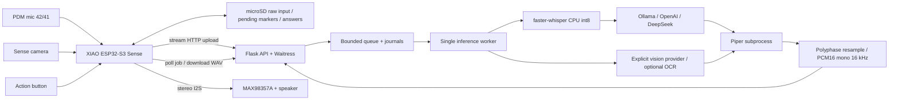
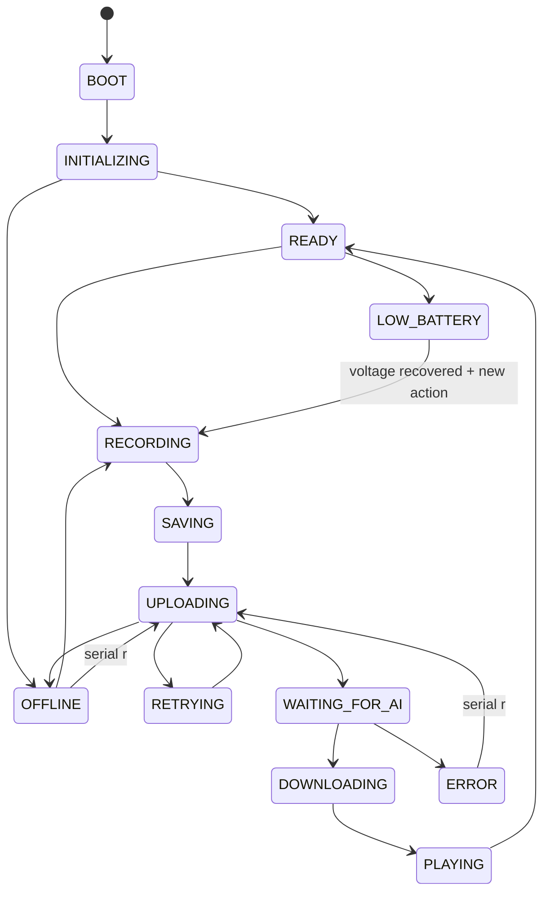

# Architecture



## Voice and camera flow

```mermaid
sequenceDiagram
  participant U as User
  participant E as XIAO
  participant A as API
  participant W as Worker
  U->>E: Short press/release
  E->>E: Record 5 s to SD; save pending marker
  E->>A: POST audio/wav (stream file)
  A-->>E: 202 + job ID
  A->>W: Queue durable input
  W->>W: STT -> LLM -> TTS -> validate WAV
  loop Every 2 s, until deadline
    E->>A: GET job status
    A-->>E: queued / processing / completed / failed
  end
  E->>A: GET answer audio
  A-->>E: PCM WAV + Content-Length
  E->>E: Incremental SD download; validate; play
  E->>E: Remove pending marker; READY
```

A long press/release selects JPEG capture. The camera is initialized only during capture, first frame discarded, then its JPEG is saved. Illumination is optional. It is deinitialized afterward. The image job invokes a separate vision adapter, then TTS. A missing vision provider yields `VISION_NOT_CONFIGURED`, preserving the input. The text LLM never receives a JPEG disguised as text. Optional OCR adds untrusted extracted text to the vision question; it does not replace pixel input.

## Firmware states and recovery



Capture, SD writes, individual network calls and playback are synchronous but bounded. The main loop remains responsive while waiting between polls; it does not wait inside a long STT/LLM/TTS HTTP request. Button events while busy are discarded. Recording uses a byte target and wall-clock deadline with a 500 ms I²S read timeout. Playback duplicates each mono sample to left and right slots and uses a 1 s write timeout. Microphone and speaker have separate short-lived I²S objects; each calls `end()` before the other starts. Camera runs separately. Simultaneous peripheral behavior requires hardware verification.

Captures use random filenames. Each complete capture has a `.pending` sidecar with the server job ID once known. Serial `r` discovers a pending file after reboot and resumes polling or resubmits it. A failed/expired server job clears the ID for the next retry. Original WAV/JPEG remains until the user archives/deletes it. Failed partial recordings remain for diagnostics but are not marked for upload. SD space is not silently reclaimed; check it before long demonstrations.

Uploads retry at most three times with a 3 s pause. If a POST was accepted but its response was lost, retry can create a duplicate server job; this prototype does not implement an idempotency key. This is documented, and retries remain bounded. Offline inputs are not automatically flooded back to the server: `r` processes one pending capture at a time. Serial recovery is the initial product interaction; a future button/UI retry gesture can be added.

## Laptop worker, timeouts and storage

HTTP handlers validate input before creating a UUID directory. The directory stores the unmodified input, atomic `job.json`, and a separately generated answer. Uploads are bounded (1 MB WAV, 2 MB JPEG by default); audio duration is capped at 30 s and images at 12 megapixels. Job admissions are serialized with an RLock. One worker protects Whisper from concurrent invocation and limits CPU load. HTTP threads remain available for status/download.

Default queue capacity is four waiting jobs and one active worker; total retained jobs are limited to 100. When either bound is reached, new work returns 503. A watchdog applies the 180 s deadline from admission, including queue wait, and removes terminal jobs/files after 24 h. Download bytes are copied under the manager lock so cleanup cannot delete a file mid-read. Restart reloads journals; queued/processing jobs become `SERVER_RESTARTED`, retaining inputs for resubmission. A single process must own the data directory. It is not a distributed or production job system.

Network provider calls have 5 s connect and configurable read timeouts; Piper/OCR subprocesses have hard subprocess timeouts. Native Whisper cannot be forcibly cancelled safely in a Python thread. The watchdog marks a timed-out job failed and prevents publishing any late answer, but a stuck native call keeps the one worker busy. No replacement threads are spawned; the queue stays bounded. Restart the server if status shows a failed active job that does not release. Move inference to a supervised process for stronger recovery in a future version. HTTP read timeouts also measure periods of inactivity, not a strict aggregate provider wall time; the independent job deadline handles the visible result.

## Inference and trust boundaries

Local mode uses Whisper, Ollama and Piper without paid keys. Cloud text mode sends only the transcript to the selected provider; cloud vision sends the JPEG and question. This data movement is intentional when those modes are configured. Keys stay in environment/ignored `.env` and are never sent to firmware. The API token guards every `/api/*` endpoint and all job data; `/healthz` contains liveness only. One shared token means one trust domain, not individual device accounts.

Production improvements include TLS/device identities, process supervision, durable external queues, storage quotas, upload idempotency, and model capability checks. Current error strings deliberately omit external response bodies and exception details that may contain credentials.
