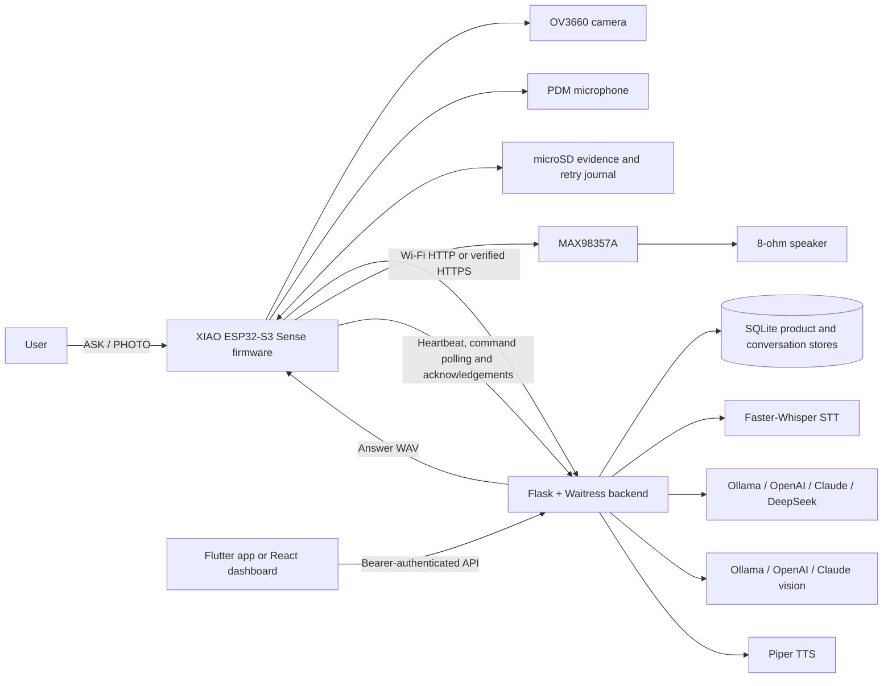
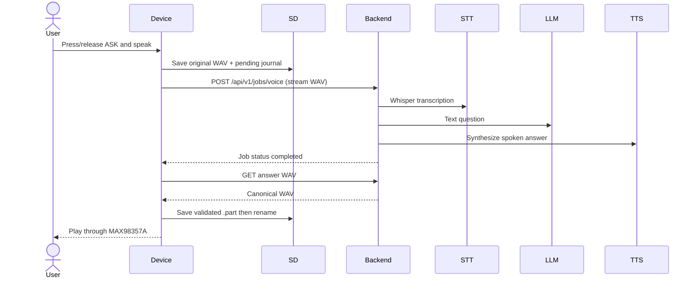
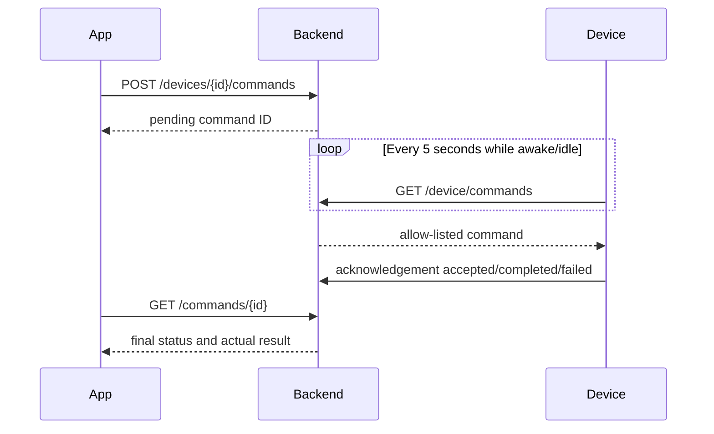

# InspectPin AI — Complete System Handoff

> **Purpose:** This is the sanitized, source-verified handoff for a developer or a new ChatGPT session. It explains the current repository, active hardware, firmware, backend, AI pipeline, communication protocols, applications, operation, testing, limitations, and safe next steps.
>
> **Audit date:** 2026-11-24  
> **Repository:** `E:\University Files\CS2\EE356\InspectPin`  
> **Important:** Never paste private `.env` or `config.local.h` values into ChatGPT, documentation, screenshots, commits, or issue reports.

---

## Evaluation release addendum, 24 November 2026

The single-layer evaluation build adds long-press standalone audio and silent video, authenticated upload and original download, inspection notes and PDF updates, workspace processing modes and a hosted receiver recipe. The sections below describe the audited baseline where their controls or build counts differ. The operator confirmed battery-powered operation. Validation of the new recording gestures on the assembled unit is open.

For current build paths and test counts use [release notes](RELEASE_NOTES.md). For the laptop launcher, gesture durations and the nameplate exercise use the [user manual](USER_MANUAL.md). The [media architecture](MEDIA_RECORDING_ARCHITECTURE.md), [cloud guide](CLOUD_DEPLOYMENT_GUIDE.md), [commercial roadmap](COMMERCIALIZATION_ROADMAP.md) and [acceptance log](PHYSICAL_ACCEPTANCE_TESTS.md) describe the remaining release gates.

## 1. Executive summary

InspectPin AI is a network-connected visual and voice inspection prototype built around a Seeed Studio XIAO ESP32-S3 Sense. The device can capture a photograph or record a spoken question, save the original media to microSD, send it over Wi-Fi to a Python backend, run local or cloud AI, download a generated WAV answer, and play it through a MAX98357A I2S amplifier and speaker.

The repository contains four cooperating software surfaces:

1. **ESP32-S3 firmware** in `firmware/InspectPinAI`.
2. **Python/Flask backend** in `backend`.
3. **Flutter mobile/laptop application** in `mobile_app`.
4. **React web dashboard** in `web`.

It also contains a labelled virtual-device simulator, automated tests, historical hardware designs, and manufacturing material.

The connected and deployed board is the **latest single-layer PCB profile**, not the older Rev E and not Rev N. The active board has two buttons, the camera, microphone, microSD, MAX98357A amplifier, speaker, battery power, and Wi-Fi. It does **not** expose firmware-controlled flashlight, vibration, PCF8574, battery ADC, or charger status. Those older/alternate-profile modules remain in the source tree for architecture compatibility but are disabled in the active build.

The operator confirmed battery-powered operation on 24 November 2026. The backend uses SQLite and in-process workers. Commercial release work includes hosted HTTPS deployment, Android release signing and OTA updates.

---

## 2. Source-of-truth rules

The repository includes several hardware generations and documents written at different times. Apply this precedence order:

1. Current source code and compile-time profile.
2. `docs/SINGLE_LAYER_BOARD_PROFILE.md` for the connected PCB.
3. The latest measured serial output and physical continuity checks.
4. Rev N or Rev E documents only when deliberately building those separate profiles.

Do not combine pin assignments across hardware revisions.

### Active versus historical functionality

| Area | Current single-layer product | Present elsewhere but inactive/historical |
|---|---|---|
| ASK button | D4 / GPIO5 | Older bench D2 / GPIO3; Rev N PCF8574 input |
| PHOTO button | D7 / GPIO44 | Older bench D5 / GPIO6; Rev N PCF8574 input |
| Amplifier shutdown | D5 / GPIO6 | Not present in old bench layout |
| Speaker I2S | GPIO1, GPIO2, GPIO4 | Rev N uses a different mapping |
| Battery measurement | Unavailable | Rev E divider and Rev N INA219 code |
| Charge status | Unavailable | Proposed/alternate decoder logic |
| Flashlight | Removed/disabled | Generic controller and other board profiles |
| Vibration | Removed/disabled | Generic feedback and other board profiles |
| PCF8574 | Disabled | Rev E/Rev N architecture |
| Video | Bench/experimental firmware path | Not a finished product workflow |

The backend and app remote-command allowlist intentionally exposes only photo capture, pending-upload retry, status, speaker volume, and idle timeout. It does not expose flashlight or vibration.

---

## 3. System architecture



There are two related backend planes:

- The **embedded inference plane** is the proven device path: image registration, voice upload, AI-job polling, WAV download, and per-device image context.
- The **product management plane** adds accounts, secure device pairing, telemetry, remote commands, inspection history, AI configuration, reports, and app/dashboard access.

The firmware currently uses the embedded inference plane for voice and image processing and the product plane for heartbeat and remote commands. A successful firmware image registration is also mirrored into the product inspection library when the device is paired.

---

## 4. Current hardware profile

### 4.1 External pin allocation

These GPIO numbers are the numbers used in firmware:

| XIAO pin | ESP32-S3 GPIO | Current function | Electrical behavior |
|---|---:|---|---|
| D0 | 1 | MAX98357A BCLK | I2S output |
| D1 | 2 | MAX98357A LRC/WS | I2S output |
| D3 | 4 | MAX98357A DIN | I2S output |
| D4 | 5 | ASK button | Active LOW; external 10 kΩ pull-up; wake source |
| D5 | 6 | Amplifier shutdown | HIGH = amplifier off; LOW = amplifier on |
| D7 | 44 | PHOTO button | Active LOW; external 10 kΩ pull-up; awake only |

Do not allocate D8, D9, or D10 to new functions. The Sense microSD interface uses GPIO7, GPIO8, GPIO9, and chip-select GPIO21 internally.

### 4.2 Internal Sense peripherals

The firmware preserves the official Sense connections:

- PDM microphone clock: GPIO42.
- PDM microphone data: GPIO41.
- microSD: CS 21, SCK 7, MISO 8, MOSI 9.
- Camera: XCLK 10, SCCB SDA 40, SCCB SCL 39, data 15/17/18/16/14/12/11/48, VSYNC 38, HREF 47, PCLK 13.

### 4.3 What is not available on this PCB

The active profile sets the following features off:

- Battery voltage measurement.
- True charging/charged-state measurement.
- PCF8574 expansion.
- Flashlight output.
- Vibration output.
- INA219 and NTC monitoring.

Therefore the app must display battery and charge information as unavailable rather than inventing a value. Battery voltage alone would not prove charge completion even if a voltage divider were later added.

### 4.4 Power and sleep behavior

- The configured inactivity timeout is 300 seconds (five minutes).
- Before deep sleep the firmware disconnects Wi-Fi, closes SD/settings access, drives amplifier shutdown HIGH, and holds that level.
- ASK/GPIO5 is configured as an active-LOW deep-sleep wake source.
- Waking from deep sleep resets and restarts the firmware. The wake press is normally consumed by waking; press ASK again after the device reaches READY to record a question.
- PHOTO/GPIO44 works while awake but is not the configured deep-sleep wake source.
- A sleeping device cannot poll the server, so an app command cannot wake it over Wi-Fi.

---

## 5. Firmware architecture

### 5.1 Entry point and supervision

`firmware/InspectPinAI/InspectPinAI.ino` creates one `App` object. `setup()` starts USB serial at 115200, initializes the application, enables the loop watchdog, and sets a 30-second watchdog limit. `loop()` feeds the watchdog, executes `app.tick()`, and yields briefly.

Boot initialization is deliberately completed before watchdog supervision because SD recovery and hotspot association may take several seconds.

### 5.2 Major modules

| Module | Responsibility |
|---|---|
| `app_state_machine.*` | Top-level orchestration, state changes, capture, upload, retry, polling, playback, heartbeat, remote commands and sleep |
| `hardware_profile.h` | Mutually exclusive pin maps for single-layer, Rev N and legacy/Rev E builds |
| `config.h` | Private/public configuration selection, feature flags, limits and compile-time conflict checks |
| `command_types.*` | Typed commands from serial, voice, HTTP, buttons and internal policy |
| `command_dispatcher.*` | Rejects invalid, unsafe, duplicate/busy or state-incompatible commands |
| `state_model.h` | Legal top-level and active-state transitions |
| `operation_guard.h` | Ensures only one capture/network/playback/recovery operation owns resources |
| `button_manager.*` | Debounces active-LOW ASK and PHOTO inputs and triggers on release |
| `camera_manager.*` | OV3660 initialization, optimized profile, warm-up, validation, JPEG save and recovery |
| `audio_recorder.*` | Records 16 kHz, mono, PCM16 WAV from the PDM microphone directly to SD |
| `audio_player.*` | Validates answer WAV, expands mono to stereo I2S, applies volume, controls MAX98357A shutdown |
| `sd_manager.*` | SD initialization, unique filenames, pending journals, retries and self-test |
| `api_client.*` | Device authentication, streaming uploads, polling, WAV download, heartbeat and command acknowledgements |
| `wifi_manager.*` | Bounded station association, reconnection and scan diagnostics |
| `power_manager.*` | Inactivity tracking, light/deep sleep, ASK wake source and peripheral shutdown |
| `settings_store.*` | Persistent NVS settings such as volume and idle timeout |
| `event_log.*` | Compact device event/state diagnostics |
| `video_recorder.*`, `avi_writer.*` | Experimental QVGA AVI bench recording, not the primary commercial workflow |
| Battery/charge/PCF/light/haptic/NTC/INA modules | Alternate hardware-profile support; disabled on the active board |

### 5.3 Firmware states

The human-readable states are:

`BOOT → INITIALIZING → READY → RECORDING → SAVING → UPLOADING → WAITING_FOR_AI → DOWNLOADING → PLAYING → READY`

Recovery states include `OFFLINE`, `RETRYING`, `ERROR`, and `LOW_BATTERY`. Video has `VIDEO_RECORDING`. The typed runtime model separately records top-level states and active operations so invalid transitions can be rejected.

### 5.4 Boot sequence

At boot, the firmware:

1. Starts the event log and moves to INITIALIZING.
2. Holds the amplifier off.
3. Initializes optional-profile managers, buttons, power and settings.
4. Loads the saved idle timeout and speaker volume.
5. Prints PSRAM, heap, device ID, active pins and serial commands.
6. Mounts microSD and creates `/inspectpin` if necessary.
7. Recovers any incomplete experimental video.
8. Connects to Wi-Fi and synchronizes the current backend image context.
9. Enters READY, or OFFLINE if the hotspot/backend is not reachable.

The device ID is either configured explicitly or derived from the ESP32 eFuse MAC in the form `pin-xxxxxxxxxxxx`.

### 5.5 Button behavior

Both buttons are debounced for 40 ms and trigger on a valid press-and-release sequence:

- ASK starts a five-second microphone recording.
- PHOTO captures and registers a JPEG.

A button already held during reset is not armed, preventing a false action on release.

### 5.6 Serial commands

At 115200 baud:

| Key | Action |
|---|---|
| `v` | Record a voice question |
| `c` | Capture/register a photo |
| `u` | Start experimental video |
| `o` | Stop experimental video |
| `m` | List media |
| `k` | Print/verify camera profile |
| `i` | Inspect/synchronize conversation context |
| `x` | Clear image and conversation context |
| `r` | Retry one pending SD item |
| `s` | Run SD write/read/delete self-test |
| `w` | Scan Wi-Fi and reconnect |
| `b` | Print battery/charge diagnostics; active board reports invalid/unavailable |
| `p` | Play `/tone.wav` if present |
| `z` | Enter configured sleep mode when safe |
| `d` | Print raw button levels |
| `?` | Print status |

Serial Monitor works only over USB. Once the cable is disconnected, the board can continue working over Wi-Fi, but Arduino Serial Monitor cannot show its log. Remote status is available through heartbeat/API data; full remote log streaming is not implemented.

### 5.7 SD evidence and offline recovery

Every voice or photo input receives a randomized unique filename in `/inspectpin`, for example a hexadecimal/millisecond-based `.wav` or `.jpg`. The firmware does not overwrite the last good capture.

After capture, it creates a JSON `.pending` sidecar containing the server job ID and the exact image/context binding. This makes a retry use the original image association rather than silently attaching a later photo. Completed work removes only the pending marker; the original media remains on SD as evidence.

If Wi-Fi, HTTP, AI, or playback fails, the input remains on SD. Restore connectivity and issue `r`. Errors are bounded; the firmware does not wait forever.

### 5.8 Voice capture and playback

The microphone path records:

- 16,000 samples/second.
- Mono.
- Signed 16-bit PCM.
- Five seconds by the active configuration.
- 160,044 bytes for a complete five-second WAV including the header.

It writes directly to SD, calculates peak and RMS for diagnostics, and repairs the WAV header with the actual byte count. Partial recordings are retained for diagnosis but are not uploaded as successful captures.

Answer playback validates PCM16/16 kHz WAV data, streams it from SD, duplicates mono samples into both standard-I2S slots, applies the saved 0–100% volume, enables the amplifier only during playback, and shuts it down afterward. The compile-time playback gain is 1.0, so the firmware does not attenuate the already peak-limited backend audio. Backend TTS normalization currently limits peaks to reduce distortion; further loudness changes must be assessed against clipping and amplifier/speaker power rather than blindly increasing gain.

### 5.9 OV3660 camera profile

The active camera path requires PSRAM and an OV3660 sensor. It uses:

| Setting | Active value |
|---|---:|
| XCLK | 20 MHz |
| Pixel format | JPEG |
| Resolution | SVGA, 800 × 600 |
| JPEG quality | 12 |
| Frame buffers | 1 in PSRAM |
| Brightness | +1 |
| Contrast | 0 |
| Saturation | -2, provisional because original `/status` JSON was unavailable |
| Sharpness | +1 |
| Denoise | 5 |
| Exposure level | 0 |
| AWB / AWB gain | Enabled |
| AWB mode | 0, automatic |
| AEC / AGC / gamma | Enabled |
| Night mode (AEC2) | Disabled |
| Lens correction | Enabled when driver supports it |
| Advanced AWB/DCW | Enabled |
| Vertical flip | Enabled for OV3660 orientation correction |
| Gain ceiling | Preserved from initialized driver because exact manual value is unknown |
| Warm-up | 500 ms and two discarded frames |

`applyOptimizedCameraProfile(sensor_t*)` is the central profile function. Setters and driver status readbacks are checked. The profile is applied after initialization and checked again before capture. A failed capture shuts the camera down, reinitializes it, reapplies the profile, and retries once. A saved frame must be JPEG, non-empty, no larger than two MiB, and exactly 800 × 600. The frame buffer is always returned after writing.

An explicit low-light test profile exists, but firmware never selects it automatically. Experimental video temporarily uses a separate QVGA bench profile, then shuts the camera down; the next still capture reinitializes the approved SVGA profile.

### 5.10 Firmware network security

The firmware sends `X-Device-ID` and `X-Device-Token` with device API calls. It supports:

- Private-LAN HTTP for prototype bench work.
- HTTPS only when a trusted root CA is compiled into `IP_SERVER_CA_CERT`.

It never calls an insecure TLS bypass. Credentials reside in ignored `config.local.h`, not in committed templates. A production unit must receive a unique per-device credential rather than the development shared token.

---

## 6. End-to-end workflows

### 6.1 Voice-only question



The backend first checks WAV format and RMS. Below-threshold/silent audio returns `NO_SPEECH`. A bounded worker performs STT, deterministic command classification when appropriate, LLM reasoning, speech normalization, Piper synthesis, and canonical WAV validation.

### 6.2 Photo then visual question

1. Press/release PHOTO or issue `c`/remote capture.
2. Firmware initializes the camera, applies/verifies the OV3660 profile, warms exposure/white balance, and saves the original JPEG.
3. Firmware streams the JPEG to `POST /api/v1/images`.
4. Backend validates JPEG completeness/dimensions, stores it, creates a per-device image/context ID, and mirrors it into the paired user’s inspection library.
5. Firmware stores the returned image/context IDs.
6. Press ASK and ask a question such as “What component is this?”
7. The WAV job explicitly includes the image ID and context ID.
8. Backend transcribes speech, loads that exact JPEG, sends pixels plus question/history to a vision-capable model, creates speech, and returns the answer.
9. Further ASK questions reuse the same image until it expires, is replaced, or is cleared.

The default image-context lifetime is 300 seconds and the default history is bounded to six turns. The backend never guesses the globally latest image. It requires the active image ID, verifies device ownership, rejects changed/expired context, and serializes one active turn per device.

### 6.3 Remote app command



Remote commands expire and are ownership checked. The device must be awake, connected, paired, idle, and polling. Capture and retry are asynchronous; the firmware acknowledges acceptance and later sends completion/failure.

### 6.4 Offline operation

The device can capture to SD when the network is unavailable. It cannot perform AI locally. The state becomes OFFLINE and the pending marker remains. When the hotspot and backend return, issue `r` for pending items. A changed or expired visual context is reported explicitly rather than attaching the audio to a different image.

---

## 7. Backend architecture

### 7.1 Process startup

`backend/receiver.py`:

1. Changes working directory to `backend`.
2. Loads ignored `.env` without overriding already-set environment variables.
3. validates typed settings.
4. Refuses to start a duplicate listener on the configured address/port.
5. Creates the Flask application and model/service objects.
6. Serves with Waitress using one process and four HTTP threads.
7. Closes product jobs, stores and inference jobs during orderly shutdown.

Do not use the Flask debug reloader with the shared SQLite/data directory and model workers.

### 7.2 Service construction

`backend/inspectpin/pipeline.py` constructs four services:

- STT: mock or Faster-Whisper.
- Text LLM: mock, Ollama, OpenAI, Anthropic Claude, or DeepSeek.
- TTS: mock or Piper.
- Vision: disabled, mock, Ollama, OpenAI, or Anthropic Claude.

Models are initialized once at application creation where applicable. Per-account AI configuration can replace the text and vision providers while sharing STT and TTS.

### 7.3 Inference job manager

`JobManager` owns:

- A bounded in-memory queue.
- One inference worker thread.
- One deadline/retention watchdog.
- Durable `job.json` journals and media folders.
- The per-device conversation store.

Jobs move through `queued`, `processing`, `completed`, or `failed`. On restart, unfinished journals become `SERVER_RESTARTED`; inputs remain available for resubmission. Terminal jobs are removed after the configured retention time, normally 24 hours.

Python cannot forcibly stop a native Whisper call. A timed-out native call can occupy the single worker until it returns, although the watchdog marks the job failed. This is a known prototype limitation.

### 7.4 AI pipeline stages

For a voice job:

1. Parse WAV and enforce minimum RMS.
2. Transcribe with Faster-Whisper.
3. If there is no image, check a strict deterministic command phrase allowlist.
4. Otherwise select vision or text reasoning using explicit context.
5. Require a non-empty answer.
6. Normalize Markdown, electronic units, reference designators and symbols into spoken English.
7. Synthesize with Piper into a temporary WAV.
8. Resample/normalize/peak-limit into canonical PCM16 mono 16 kHz.
9. Atomically publish `answer.wav` and expose it only after completion.

Deterministic voice commands include photo capture, status, battery status, video bench controls, cancellation, volume, sleep, and restart confirmation. Unmatched speech goes to the AI provider. The current remote product allowlist is narrower than the internal command taxonomy.

### 7.5 Grounding and safety prompts

The text and vision system prompts require concise spoken responses, visible-fact versus inference separation, uncertainty for unreadable labels, no invented measurements, and appropriate warnings for dangerous electrical work. Image/OCR text is treated as untrusted data rather than instructions.

These prompts reduce risk but do not make model output a certified inspection. InspectPin cannot determine electrical isolation, internal faults, live voltage/current, or equipment safety from a photograph.

### 7.6 Provider adapters

| Provider | Text | Vision | Interface used |
|---|---|---|---|
| Ollama | Yes | Yes with a vision-capable model | Local `/api/chat` |
| OpenAI | Yes | Yes | Responses API |
| Anthropic Claude | Yes | Yes | Messages API |
| DeepSeek | Yes | Not currently exposed for vision | Chat completions |
| Mock | Transport tests only | Transport tests only | No genuine reasoning/pixel analysis |

Typical local configuration uses `llama3.2:3b` for text and `qwen2.5vl:3b` for vision. `llama3.2` is explicitly rejected as a vision model. Provider model names and availability change; verify current provider documentation/account access before configuration.

An OpenAI API key is separate from a ChatGPT subscription. An Anthropic API key is separate from a Claude consumer subscription.

### 7.7 Speech-to-text

Faster-Whisper uses the configured model, CPU/device, quantization, language, VAD and beam size. The normal development default is `base.en`, CPU, int8, English, VAD enabled, beam size five. Missing/incompatible models return a diagnostic failure; the system does not fabricate a transcript.

### 7.8 Text-to-speech

Piper requires both the `.onnx` voice and matching `.onnx.json`. The active voice path invokes Piper in a bounded subprocess, then normalizes output. `speech_text.py` expands common component units and symbols so the speaker says “ohms,” “microfarads,” “resistor 12,” “number,” and similar spoken forms instead of reading Markdown hash marks or corrupt symbols.

### 7.9 Product store and database

`ProductStore` is a thread-safe, single-process SQLite repository. Tables include:

- `users` and hashed passwords.
- `user_sessions` with hashed bearer tokens and expiry.
- `devices` with hashed per-device tokens and last heartbeat telemetry.
- `inspections`, `media`, and `voice_interactions`.
- `processing_jobs` with optional idempotency keys.
- `device_commands` with status, expiry and result.
- `uploads` with chunk/checksum metadata.
- `audit_events`.
- Per-owner encrypted `ai_configurations`.

Product media is stored below `backend/data/product-media`; resumable chunks use `backend/data/uploads`. Embedded inference jobs and conversation images have separate storage because the product layer was added without replacing the already-working device pipeline.

### 7.10 Account-specific AI configuration

Authenticated users can select providers/models and submit OpenAI, Anthropic or DeepSeek keys. Keys are encrypted with Fernet at rest and are write-only: API responses return only `has_*_key` flags.

- Development creates an ignored local encryption-key file if none is supplied.
- Production refuses to start without an externally managed `CONFIG_ENCRYPTION_KEY`.
- Provider URLs/model IDs and required credentials are validated.
- The backend caches per-owner service objects and invalidates them after configuration changes.
- A paired device resolves the AI configuration of its owning user.

### 7.11 HTTP security controls

- Device tokens are compared safely and stored hashed in the product database.
- User access tokens are stored hashed and have an expiry.
- Object access is owner-scoped.
- Uploads have type and size limits.
- JPEGs are fully decoded/verified and limited to 12 megapixels.
- Responses use `Cache-Control: no-store` and `X-Content-Type-Options: nosniff`.
- CORS reflects only exact configured origins; it does not use a wildcard.
- Provider exception details and credentials are not returned to clients.

Private-LAN HTTP does not encrypt audio, images or credentials. It is for a trusted bench network only.

---

## 8. API and communication contract

### 8.1 Authentication

Two authentication modes exist:

- User/app requests: `Authorization: Bearer <access-token>`.
- Device requests: `X-Device-ID` plus `X-Device-Token`.

The development shared `DEVICE_TOKEN` bridge exists for already-flashed bench firmware. Production should use the unique token returned once during device pairing.

Errors use a stable JSON form:

```json
{
  "error": {
    "code": "STABLE_CODE",
    "message": "Safe explanation"
  }
}
```

### 8.2 Embedded inference endpoints

| Method and path | Purpose |
|---|---|
| `GET /healthz` | Process liveness |
| `GET /api/v1/status` | Authenticated services/queue diagnostics |
| `POST /api/v1/images` | Register exact JPEG and establish image context |
| `GET /api/v1/images/{id}` | Image metadata |
| `GET /api/v1/images/{id}/content` | Original JPEG |
| `GET /api/v1/session` | Current device image/conversation context |
| `DELETE /api/v1/session` | Clear context |
| `POST /api/v1/jobs/voice` | Stream WAV, optionally with image/context IDs |
| `POST /api/v1/jobs/image` | Legacy one-shot JPEG analysis |
| `POST /api/v1/jobs/question` | Typed question using explicit context |
| `GET /api/v1/jobs/{id}` | Poll job state/transcript/answer |
| `GET /api/v1/jobs/{id}/audio` | Download completed answer WAV |

Successful job submission returns HTTP 202 plus a `Location` header. The firmware polls every two seconds with an overall 240-second device deadline.

### 8.3 Product endpoints

The product API includes:

- Health/readiness.
- Register, login, refresh, logout and current user.
- AI configuration and connection testing.
- Pair/list/read/rename/revoke devices.
- Issue/list/read remote commands.
- Device heartbeat, command poll and acknowledgement.
- Resumable upload initialization, chunks and checksum completion.
- Create/list/read/delete inspections.
- Upload JPEG/WAV inspection media.
- Start vision analysis and ask follow-up questions.
- Poll processing jobs.
- Download protected media and generated PDF reports.
- Read an authenticated server-sent-event snapshot.
- Retrieve a compact OpenAPI summary.

### 8.4 Remote command allowlist

| API command | Firmware action | Constraint |
|---|---|---|
| `capture_photo` | Capture/register JPEG | Device awake, online and idle |
| `retry_upload` | Retry pending SD input | Pending item required |
| `status` | Print/report current state | Observational |
| `set_volume` | Save 0–100% output volume | Integer only |
| `set_idle_timeout` | Save 30–3600 seconds | Cannot wake sleeping device |

Unknown command types and invalid payloads are rejected by both server and firmware.

### 8.5 Heartbeat

While awake and connected, the firmware sends heartbeat data approximately every 30 seconds, excluding active capture/upload/download/playback states. It includes state, firmware version, SD capacity/use, Wi-Fi RSSI and connection type. On the active single-layer profile, battery fields are null/unavailable and charging validity is not claimed.

A device is considered online from recent heartbeat state; this is not the same as a persistent socket. Command delivery is polling, not push.

### 8.6 Resumable uploads

The product API supports idempotent, chunked media uploads with declared total size, SHA-256, content type and chunk size. Completion verifies the exact digest before publishing. This path exists for product evolution; the active embedded voice/photo workflow currently streams complete SD files directly through its proven endpoints.

---

## 9. Flutter application

### 9.1 Purpose and platforms

`mobile_app` is an Android-first Flutter client and also has a web runner for laptop testing. It includes onboarding, account authentication, dashboard, device management/control, inspection history, grounded assistant, AI provider configuration, theme selection, and backend-origin configuration.

### 9.2 Application flow

`main.dart`:

1. Loads the saved backend URL and access token from secure storage.
2. Restores the session with `/auth/me`.
3. Shows splash and first-run onboarding.
4. Shows login/registration when signed out.
5. Opens the main shell when authenticated.

The default API URL is `http://10.0.2.2:5000`, which reaches the Windows host from an Android emulator. Physical phones must use the laptop’s current private hotspot/LAN address or a public HTTPS URL.

### 9.3 Security behavior

- Access tokens and configured backend origin are stored with `flutter_secure_storage`.
- A backend origin may not contain embedded credentials, path, query or fragment.
- Plain HTTP is accepted only for loopback, emulator host, or RFC1918 private-LAN addresses.
- Public remote origins must use HTTPS.
- Cloud provider keys are submitted once to the authenticated backend, cleared from input controllers, encrypted server-side, and never read back.

The current Android manifest permits cleartext traffic so private-LAN bench testing works. A commercial release should use build-flavor-specific network security rather than a broad cleartext allowance.

### 9.4 Main screens

- **Dashboard:** live device state, Wi-Fi, storage, battery truthfulness and recent inspections.
- **Device control:** remote photo, retry, volume slider and idle-timeout control.
- **Inspections:** original protected JPEG, analysis status, visible findings and conversation history.
- **Assistant:** asks a question about a selected inspection; it is grounded to stored evidence.
- **AI configuration:** Ollama/OpenAI/Anthropic/DeepSeek text selection, supported vision selection, model IDs, Ollama URL, write-only keys and connection test.
- **Pairing:** accepts the stable firmware ID and returns a one-time device token for provisioning.

The UI deliberately does not expose flashlight or vibration controls.

### 9.5 Battery presentation

The app parses battery voltage/percentage only when a valid hardware reading is present. It never derives charging/full state from voltage. For the current board it should show unavailable. The data types still support calibrated estimates and real charger states for future compatible hardware.

### 9.6 Android status

- Application ID: `ai.inspectpin.mobile`.
- Internet permission is present.
- Java/Kotlin target: Java 17.
- A debug APK can be built and installed.
- The release build currently uses debug signing and is not suitable for a store/commercial release.
- iOS release work requires macOS, Xcode, Apple signing, privacy declarations and device testing.

---

## 10. React web dashboard

`web` is a separate Vite/React/TypeScript dashboard. It is not the same renderer as Flutter web. It provides:

- User registration/login and session-scoped browser token storage.
- Dashboard telemetry and inspection cards.
- Device pairing, capture and unpairing.
- Inspection search/filter/order.
- Protected original-media display.
- Grounded questions tied to selected inspection evidence.
- PDF report download.
- Dark/light theme and privacy boundaries.

The browser access token is kept in `sessionStorage`, while theme preference uses `localStorage`. Media requests carry the bearer token and use blob URLs. Pairing clearly states that BLE discovery is not implemented.

The React dashboard currently does not expose the same AI-provider settings or detailed device controls as the Flutter client. Treat Flutter as the richer control/configuration application and React as the product dashboard/demo surface.

---

## 11. Virtual device simulator

`simulator/inspectpin_simulator.py` exercises the production HTTP contract without claiming physical hardware operation. It can:

- Create/login a development account and pair a virtual device.
- Send heartbeats.
- Poll and acknowledge commands.
- Create a labelled simulated inspection from a fixture JPEG.
- Run analysis/follow-up/voice jobs.
- Simulate offline state, missing SD and battery percentage.

All simulator-created inspections are marked `simulated=true`. Mock AI responses explicitly say they did not inspect pixels. Simulator credentials are stored in ignored `.build` state and should be revoked/deleted after testing.

---

## 12. Repository map

```text
InspectPin/
├── backend/                 Flask/Waitress API, AI services, stores and tests
│   ├── inspectpin/          Main Python package
│   ├── scripts/             Model/download/diagnostic utilities
│   ├── tests/               Backend, firmware-contract and UI-contract tests
│   ├── data/                Runtime databases/media; private and ignored
│   └── models/              Local Whisper/Piper assets; large/private
├── firmware/InspectPinAI/   Active ESP32-S3 firmware
├── mobile_app/              Flutter Android/web application
├── web/                     React/Vite dashboard
├── simulator/               Labelled virtual device
├── docs/                    Architecture, setup, testing and hardware records
├── hardware/                Historical/reconciled hardware documents
├── REV N/                   Separate Rev N KiCad design artifacts
├── manufacturing/           Manufacturing/factory-test material
├── scripts/                 Repository utilities
├── .build/                  Generated/private test state
└── docker-compose.yml       Mock backend + React web demonstration
```

Generated directories such as `.venv`, `.tools`, Flutter build output, `node_modules`, database/media data, model files, and private configuration are not source documentation and should not be pasted into ChatGPT.

---

## 13. Configuration without exposing secrets

### 13.1 Backend

Copy an example to `backend/.env`, then edit the ignored file. Important categories are:

- `HOST` and `PORT`.
- `DEVICE_TOKEN` for development compatibility.
- STT model/device settings.
- Text provider/model and local Ollama origin.
- Vision provider/model.
- Piper model and TTS gain.
- Upload, queue, retention and timeout limits.
- Exact `CORS_ORIGIN` values.
- Deployment mode and production encryption key.

Never document actual tokens or cloud keys. If a secret has been pasted into chat or committed, rotate it.

### 13.2 Firmware

The active build uses ignored `firmware/InspectPinAI/config.local.h` with the `IP_USE_SINGLE_LAYER_CONFIG` compile flag. It contains:

- Hotspot SSID/password.
- Backend origin.
- Device credential and optional stable device ID.
- Optional HTTPS root CA.
- Capture duration, playback gain and feature flags.

Use `config.single_layer.example.h` as the sanitized template. Do not replace it with Rev E or Rev N templates.

### 13.3 App

The app’s login screen can save a backend origin. For compile-time default override:

```powershell
flutter run --dart-define=INSPECTPIN_API_URL=http://PRIVATE_LAN_IP:5000
```

Use HTTPS for any public Internet endpoint.

---

## 14. How to run the system locally

### 14.1 Prerequisites

- Windows and PowerShell.
- Python 3.12 x64 and this repository’s `.venv`.
- Ollama for local text/vision, if selected.
- Downloaded Faster-Whisper and Piper models.
- Flutter for the Flutter app.
- Node/npm for the React dashboard.
- Arduino IDE 2 / ESP32 Arduino core 3.x / ArduinoJson 7.x for firmware.
- Laptop and InspectPin on the same trusted Wi-Fi/hotspot.

### 14.2 Start local AI services

If using Ollama, start it and verify required models exist:

```powershell
ollama list
ollama serve
```

Run `ollama serve` only if the desktop service is not already running. Do not start duplicate instances.

### 14.3 Start the backend

```powershell
Set-Location 'E:\University Files\CS2\EE356\InspectPin'
.\.venv\Scripts\python.exe backend\receiver.py
```

For laptop-only UI testing, bind to `127.0.0.1`. For the physical board, set `HOST` to the laptop’s current IPv4 address on the hotspot/LAN—not the phone’s address and not an old address. A `WinError 10049` means the configured bind address is not assigned to this laptop.

Check:

```powershell
Invoke-RestMethod http://PRIVATE_LAN_IP:5000/healthz
```

Allow inbound TCP 5000 only on the trusted local network. Do not disable Windows Firewall globally and do not expose the prototype port through router forwarding.

### 14.4 Run Flutter on the laptop browser

From another PowerShell window:

```powershell
Set-Location 'E:\University Files\CS2\EE356\InspectPin\mobile_app'
..\.tools\flutter\bin\flutter.bat pub get
..\.tools\flutter\bin\flutter.bat run -d chrome --dart-define=INSPECTPIN_API_URL=http://127.0.0.1:5000
```

The backend `CORS_ORIGIN` must exactly include the browser origin chosen by Flutter. A fixed port is easier for repeatable CORS configuration.

### 14.5 Build/install Android debug APK

```powershell
Set-Location 'E:\University Files\CS2\EE356\InspectPin\mobile_app'
..\.tools\flutter\bin\flutter.bat build apk --debug --dart-define=INSPECTPIN_API_URL=http://PRIVATE_LAN_IP:5000
```

Output:

```text
mobile_app/build/app/outputs/flutter-apk/app-debug.apk
```

Install it on the phone, connect the phone and laptop to the same network, and enter the laptop’s private IP backend origin. The app does not communicate directly with the XIAO; both app and XIAO communicate through the backend.

### 14.6 Run the React dashboard

```powershell
Set-Location 'E:\University Files\CS2\EE356\InspectPin\web'
npm install
npm run dev
```

Open the Vite URL, normally `http://127.0.0.1:5173`. Configure the backend CORS origin to match.

For a fully mocked container demonstration:

```powershell
docker compose up --build
```

Then open port 8080. The compose setup uses mock AI and proves application transport only.

### 14.7 Compile the active firmware

```powershell
& 'C:\Program Files\Arduino IDE\resources\app\lib\backend\resources\arduino-cli.exe' compile `
  --fqbn 'esp32:esp32:XIAO_ESP32S3:PSRAM=opi,USBMode=hwcdc,CDCOnBoot=default,FlashSize=8M,PartitionScheme=default_8MB' `
  --build-property 'compiler.cpp.extra_flags=-DIP_USE_SINGLE_LAYER_CONFIG' `
  firmware\InspectPinAI
```

Flash only after checking the correct COM port. Keep ASK released during reset/upload. Use Arduino Serial Monitor at 115200 baud.

---

## 15. Physical operation checklist

### 15.1 USB-connected bench start

1. Insert a suitable formatted microSD card.
2. Connect the antenna and verified peripherals.
3. Start Ollama if used, then start the backend.
4. Connect the board by USB and reset it.
5. Open Serial Monitor at 115200.
6. Require sensible PSRAM, SD initialization, Wi-Fi connection and `STATE READY`.
7. Send `d` and verify both released buttons read HIGH; press each and verify LOW.
8. Send `s` and require `SD test PASS`.
9. Send `k` and require OV3660 plus an applied-and-verified SVGA profile.

### 15.2 Test voice

1. Press and release ASK.
2. Speak immediately toward the microphone during the five-second recording window.
3. Observe complete WAV size/RMS, upload, job ID, AI wait, answer download and playback.
4. Confirm the final state returns to READY.
5. If the board is offline, restore the hotspot/backend and issue `r`.

### 15.3 Test camera plus follow-up voice

1. Place a de-energized component or printed test nameplate in bright, even light.
2. Hold the board steady and ensure the label fills much of the frame.
3. Press and release PHOTO.
4. Wait for “Image registered.”
5. Press ASK and ask one exact visible question.
6. Ask another question within five minutes without taking a new photo.
7. Compare every spoken rating/model number against the original JPEG; unreadable text must be reported as unclear.
8. Use `x` to clear context or take a new photo to replace it.

### 15.4 Test remote operation

1. Pair the stable device ID from its boot log to the user account.
2. Provision the one-time device token into the private firmware config for the next build, or use the development shared-token bridge only during bench work.
3. Keep the device awake and wait for a current heartbeat.
4. Open Device Control in Flutter.
5. Send status or photo capture.
6. Watch pending → accepted/completed/failed status.
7. Verify the resulting image appears in inspection history.

Remote capture will remain pending while the device sleeps. Press ASK to wake, wait for READY, then retry.

### 15.5 Battery-only start

1. Fully power down and remove USB.
2. Verify battery polarity, connector fit and switch position before enabling power.
3. Switch battery power on and briefly press reset if required by the board’s power path.
4. Because USB serial is absent, observe the backend for a new heartbeat within roughly 30–60 seconds.
5. Use the app to confirm the device becomes online; battery percentage should remain unavailable on this PCB.
6. Press PHOTO and verify a new inspection arrives.
7. Press ASK and verify voice response.
8. Let the unit idle for five minutes; it should disappear/offline after deep sleep.
9. Press ASK to wake, wait for boot, then press ASK again to record.

The operator confirmed a successful battery-powered test. See [physical acceptance log](PHYSICAL_ACCEPTANCE_TESTS.md). For future missing heartbeats, check the boot log for SD initialization first. The firmware attempts Wi-Fi only after the card mounts successfully.

---

## 16. Troubleshooting by symptom

### Backend fails with `WinError 10049`

`HOST` is set to an IP address not assigned to the laptop. Run `ipconfig`, use the laptop’s current hotspot/LAN IPv4 address, update firmware `IP_SERVER_URL`, restart backend, and rebuild/flash if the device address changed.

### Firmware says Wi-Fi unavailable

- Confirm laptop and board are on the same 2.4 GHz-compatible network.
- Recheck SSID/password privately.
- On iPhone hotspot, enable Maximize Compatibility if necessary.
- Send `w` to scan and reconnect.
- Check DHCP address changes and Windows Firewall.

### Upload returns `HTTP_-1`

This usually means connection/timeout rather than an HTTP application response. Check backend process, correct laptop IP/port, same network, firewall and server bind address.

### `TTS_FAILED`

- Confirm both Piper `.onnx` and `.onnx.json` exist.
- Run Piper/backend local audio checks.
- Inspect backend logs for the Piper exit code without exposing secrets.
- Confirm the virtual environment has the AI requirements.

### Speaker is clear but quiet

- Keep firmware volume at 100% and playback gain at 1.0.
- Confirm MAX98357A VIN is 5 V, ground is common, and the speaker matches safe amplifier load/power.
- Check amplifier gain-pin hardware configuration and supply droop.
- Inspect answer WAV peak on the laptop.
- Increase backend loudness only in small measured steps; clipping caused the previous noisy/unclear result.
- A larger speaker/enclosure or suitable higher-power audio stage may be required for product loudness.

### Speaker is noisy/distorted

- Reduce TTS/backend peak or volume.
- Use short I2S wires and solid ground/power decoupling.
- Separate speaker current paths from microphone/camera wiring.
- Confirm mono-to-stereo slot configuration and 16 kHz PCM input.
- Test the downloaded WAV on the laptop to distinguish backend audio from hardware amplification noise.

### Model says “hash” or reads symbols badly

The backend already removes Markdown headings and expands common units/designators. If it recurs:

- Inspect the stored textual answer and normalized spoken text.
- Add a narrowly tested normalization rule in `speech_text.py`.
- Keep model prompts free of Markdown/tables.
- Add regression tests before changing general punctuation behavior.

### Visual value is wrong

- Open the original SD JPEG and product media; do not evaluate only by spoken output.
- Improve focus, distance, lighting and framing.
- Ask one exact question at a time.
- Use a known test label and compare character-for-character.
- Try a stronger vision-capable model.
- Treat OCR as supplementary and uncertain.
- Never accept an unreadable value merely because it sounds plausible.

### `CONTEXT_CHANGED`, `IMAGE_EXPIRED`, or `IMAGE_ID_REQUIRED`

The backend is protecting image grounding. Use `i` to inspect context, `c`/PHOTO to recapture, `x` to clear, and then record the question again. Do not force a pending WAV onto a different image.

### App command remains pending

- Device may be asleep, offline, busy, unpaired, or using a mismatched credential.
- Wake it with ASK and wait for READY.
- Confirm fresh heartbeat and that the backend owns the paired ID.
- Commands expire; issue a new command after recovery.

### App browser has CORS errors

Set backend `CORS_ORIGIN` to the exact scheme, host and port used by the browser, then restart the backend. Do not solve this with `*` in a credentialed product API.

---

## 17. Testing and current evidence

### 17.1 Fresh software validation on 2026-11-24

| Check | Result |
|---|---|
| Backend pytest suite | **162 passed** in 20.00 s |
| Ruff over backend/simulator/scripts | **Passed** |
| React/Vitest | **3 passed** |
| React production build | **Passed**, 23 modules transformed |
| Flutter analysis | **No issues found** |
| Flutter tests | **3 passed** |
| Active single-layer firmware compile | **Passed** |
| Firmware flash use | 1,219,982 bytes, **36%** |
| Firmware static RAM | 60,552 bytes, **18%**, 267,128 bytes remaining |

The first Flutter command attempted an unavailable GitHub metadata fetch because network access was restricted, but local analysis completed with no issues. The explicit offline/local `flutter test --no-pub` run passed all three tests.

### 17.2 What automated tests establish

Tests cover backend API validation, authentication/ownership, product operations, AI configuration encryption behavior, provider adapters, audio processing, multimodal context separation/expiry, deterministic command routing, simulator truthfulness, single-layer pin/feature contracts, camera architecture, remote command boundaries, mobile battery truthfulness, premium UI contracts and firmware state architecture.

Automated tests do not prove real microphone accuracy, vision accuracy, loudness, battery power integrity, RF reliability, thermal behavior, or long-duration hardware stability.

### 17.3 Known physical evidence

Previous bench interaction established USB firmware operation, working buttons after correct four-leg-button wiring, successful voice flow, working speaker with a clear but low-volume compromise, Wi-Fi heartbeat/remote capture, OV3660 detection/profile output, and microSD-backed captures. Preserve original serial logs and media as evidence.

### 17.4 Still-required physical acceptance

- Complete battery-only power-path measurements and repeatable boot/heartbeat.
- Ten consecutive optimized still captures with memory tracking.
- Character-level visual-model evaluation on known labels.
- Ten or more full voice/vision/playback cycles after each audio tuning change.
- Five-minute sleep and ASK wake across repeated cycles.
- Offline capture, reboot and retry from SD.
- Current draw during READY, capture, playback and deep sleep.
- Speaker SPL/clarity and amplifier/speaker temperature.
- Hotspot reconnection and DHCP-address change recovery.
- Long-duration SD and memory reliability.
- Enclosure effects on camera, microphone, speaker and antenna.

---

## 18. Commercialization gap analysis

The repository implements a credible prototype product architecture, but the following are mandatory before commercial claims:

### Backend/infrastructure

- Replace or deliberately constrain SQLite single-process deployment.
- Use durable queues/workers and a production database.
- Store media in encrypted durable object storage.
- Deploy behind DNS, valid TLS and a reverse proxy/API gateway.
- Add rate limiting, abuse controls, quotas/cost budgets and provider failover policy.
- Add structured monitoring, alerting, backups and restore drills.
- Define privacy, retention, deletion and data-residency policy.
- Perform independent security/penetration review.

### Device fleet

- Unique factory-provisioned credential per unit.
- Secure provisioning and revocation workflow.
- Signed firmware and authenticated OTA with rollback.
- Versioned device/API compatibility policy.
- Manufacturing test fixtures and traceable pass records.
- Battery, charging, RF, EMC, thermal and product-safety validation.
- Final fabrication review based on exactly the manufactured PCB revision.

### Applications

- Production Android signing and Play Store configuration.
- iOS build/signing/testing on Mac hardware if required.
- Environment-specific network security and backend origins.
- Account recovery, deletion, consent and privacy flows.
- Push notification strategy if sleeping/offline command UX is required.
- Accessibility and real-device/browser matrix testing.

### AI product safety

- Explicit advisory-not-certified positioning.
- Evaluation sets for component labels, blur, glare and adversarial image text.
- Provider/model version governance.
- Human verification for safety-critical values.
- Usage/cost controls for cloud providers.
- Licensing review for models, voices and dependencies.

---

## 19. Known limitations and honest product statements

- The device performs visual and conversational assistance, not electrical measurement.
- A photograph cannot prove equipment is de-energized or safe.
- The active board cannot report real battery percentage or charging state.
- Remote commands cannot wake deep sleep over Wi-Fi.
- Arduino Serial Monitor requires USB; remote serial streaming is absent.
- Video is an experimental firmware/SD path, not a complete app/backend product feature.
- App/backend pairing is manual by stable ID; BLE discovery is not implemented.
- Local inference speed depends heavily on laptop CPU/GPU and model size.
- Provider/API access and pricing are external dependencies.
- In-process queues and SQLite are not horizontally scalable.
- Existing historical docs contain stale Rev E assumptions and older test counts.
- Battery-powered operation passed in the operator test. Runtime and cold-start repeatability still need measurements.

Safe wording: “InspectPin provides AI-assisted visual observations and spoken access to stored inspection evidence.”

Unsafe wording: “InspectPin certifies equipment safety, measures voltage from images, detects all faults, or provides guaranteed nameplate readings.”

---

## 20. Guidance for a future ChatGPT/Codex session

Copy the prompt below together with this file, but do not attach private configuration or runtime databases:

```text
You are continuing development of InspectPin AI in the existing repository.
Read docs/INSPECTPIN_COMPLETE_SYSTEM_HANDOFF.md first, then verify every claim
against current source and git status before editing.

The connected/deployed hardware is the latest single-layer profile selected by
-DIP_USE_SINGLE_LAYER_CONFIG. Its active pins are speaker GPIO1/2/4, ASK GPIO5,
amplifier shutdown GPIO6, and PHOTO GPIO44. D8/D9/D10 are reserved for Sense
microSD. The active PCB has no firmware flashlight, vibration, PCF8574, battery
ADC, or charger-state input. Do not reintroduce those controls or mix Rev E/Rev N
pin maps unless I explicitly request a separate hardware-profile task.

Preserve the verified microphone, microSD, Wi-Fi, OV3660 SVGA still profile,
MAX98357A playback, offline retry and explicit image-context behavior. Do not
invent hardware test passes. Do not expose .env, config.local.h, passwords,
Wi-Fi credentials, device tokens, encryption keys, or cloud API keys.

Before changing code, inspect the actual implementation and current tests.
After changing code, run the relevant backend, web, Flutter and firmware checks.
Distinguish development prototype functionality from production/commercial
requirements and identify all physical tests still needed.
```

### Rules for future changes

1. Preserve unrelated user changes in the dirty worktree.
2. Never replace private config with an example file without backup and permission.
3. Never claim a hardware result from compilation or mocks.
4. Never weaken TLS by using an insecure certificate bypass.
5. Never infer charging completion from battery voltage.
6. Never attach a question to a different/latest image implicitly.
7. Keep original evidence media unchanged.
8. Add tests for API, firmware-contract and UI behavior changes.
9. Reconcile source, docs and the correct hardware profile in the same change.
10. Treat provider/model availability as time-sensitive and verify it before recommending a commercial configuration.

---

## 21. Recommended next work order

1. Complete and document battery-only electrical measurements and repeated boot/wake tests.
2. Run the full physical camera/voice/nameplate acceptance matrix and archive original evidence.
3. Decide which frontend is the product primary; remove feature drift between Flutter and React.
4. Add backend deployment manifests for a real HTTPS staging environment.
5. Provision a unique device credential and test remote HTTPS using the compiled CA trust path.
6. Add signed release configuration for Android.
7. Design signed OTA and factory provisioning before scaling hardware.
8. Conduct independent electrical, RF, security, privacy and AI-output reviews.

---

## 22. Final status

The current codebase provides a working, test-covered development system linking physical ESP32-S3 capture, SD evidence retention, Wi-Fi communication, local/cloud multimodal AI, spoken output, user accounts, device telemetry/commands, inspection history, and two user interfaces. Its strongest engineering properties are explicit media/context binding, original-evidence preservation, truthful unavailable telemetry, allow-listed remote control, server-side secret storage, bounded operations, and recoverable offline captures.

The active firmware and all main software surfaces pass their current automated checks. Remaining work is predominantly physical validation, deployment hardening, fleet security, release engineering, and regulatory/commercial readiness—not a reason to represent the current prototype as already production certified.
