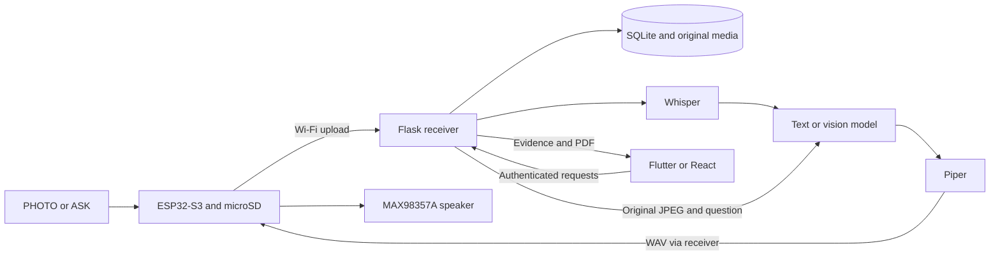

# InspectPin AI evaluation specification

**Use case.** A technician wears the assembled V13 unit, captures a de-energized equipment label, asks a question and reviews the evidence and inspector notes in a report. The operator verifies any value used for a technical decision against its source.

| Part | Evaluation configuration |
|---|---|
| Controller | XIAO ESP32-S3 Sense, single-layer production-layout prototype, 8 MB PSRAM reported on the bench |
| Camera | OV3660, JPEG 800 × 600 for stills, 20 MHz XCLK, quality 12. See the camera optimization record for individual controls and the unknown original gain ceiling. |
| Sound | Internal PDM clock/data GPIO42/41. MAX98357A BCLK/WS/DIN GPIO1/2/4. GPIO6 HIGH shuts down the amplifier. |
| Controls | ASK GPIO5 active low and wake-capable. PHOTO GPIO44 active low while awake. Both have external pull-ups. Mechanical battery switch. |
| Storage | Sense microSD CS/SCK/MISO/MOSI GPIO21/7/8/9. Preserve local originals across failed uploads. |
| Power | Single-cell battery and separate TP4056 charger. Battery operation confirmed by operator. Firmware has no charge-state, percentage, temperature or runtime measurement on this PCB. |
| Recording | Five-second AI question, independent mono 16 kHz PCM note up to 60 seconds, independent silent 320 × 240 MJPEG AVI up to 30 seconds with a 5 fps encoding target. |
| Network | Wi-Fi station, HTTP on private development LAN, authenticated HTTPS for a public host. Per-device credential in hosted mode. |
| Backend | One Flask/Waitress process, SQLite, local media directory, bounded inference queues. Whisper recognition and Piper speech. Text options include Ollama, OpenAI, Anthropic and DeepSeek. Vision supports compatible Ollama, OpenAI and Anthropic models. |
| Clients | Flutter Android and browser app, React browser dashboard. Authenticated inspection library, original media, AI settings in Flutter, notes and PDF export. |
| Build footprint | Evaluation sketch 1,226,658 bytes of 3,342,336 flash (36%); 60,584 bytes of 327,680 static RAM (18%). Heap during recording needs a device measurement. |

### System overview

For measured software results, physical evidence and remaining gates see [release notes](RELEASE_NOTES.md) and [physical acceptance](PHYSICAL_ACCEPTANCE_TESTS.md). Battery endurance, recognition accuracy across field conditions, production cost and outdoor acoustic levels have no validated figures.
