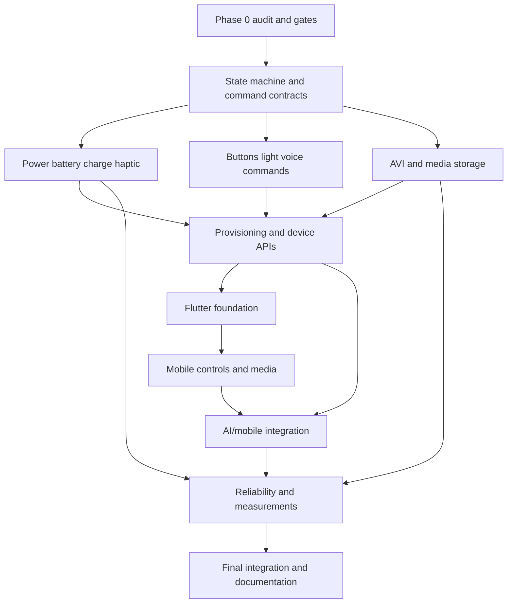

# Repository audit — Phase 0

Date: 2026-11-03 (Asia/Colombo)  
Baseline commit: `8ce2796d47d9af6deec23653b3fe3891787ced8a` on `main`  
Working tree at audit start: clean  
Local instruction file: no `AGENTS.md` found

## Phase definition of done

Phase 0 is complete only when the actual source and dependencies are inventoried; every final requirement has an implemented/partial/planned/blocked status; pin, charger, sleep, video, provisioning, and security decisions have measurable gates; current backend/static/firmware checks are executed; evidence is archived; and no later-phase product feature is presented as implemented.

## Repository inventory

| Area | Actual state |
|---|---|
| Firmware | Arduino sketch under `firmware/InspectPinAI`, split into state, audio, camera, SD, Wi-Fi, API, buttons, feedback, and battery modules. |
| Backend | Flask/Waitress package under `backend/inspectpin`, asynchronous single worker, journals, SQLite conversations, Whisper, Ollama/cloud adapters, Qwen vision, Piper, tests and scripts. |
| Mobile | `mobile_app/` absent. Flutter is not installed or not on PATH. |
| Hardware design | `hardware/` absent at audit start; Phase 0 creates only the pin decision record. No KiCad/schematic/BOM exists. |
| Documentation | Extensive existing setup, architecture, API, camera, test, troubleshooting and bench evidence plus `docs/finalization`. |
| Private configuration | Ignored `backend/.env` and `firmware/InspectPinAI/config.local.h` exist. Only key names were inspected; values were not copied into evidence. |

## Implemented source behavior

- Firmware records canonical five-second 16 kHz PCM16 mono WAV to SD, journals pending work, streams uploads, polls jobs, downloads/validates answer WAV, and plays through MAX98357A.
- OV3660 is initialized only for capture. The centralized photo profile enforces JPEG/SVGA 800×600, performs setter/readback verification, warms up, validates JPEG framing/dimensions, and saves unique SD files.
- A current private configuration enables D2/GPIO3 voice and D5/GPIO6 camera buttons. The generic source also supports one-button short voice/long camera behavior.
- Firmware state is a flat enum: BOOT, INITIALIZING, READY, RECORDING, SAVING, UPLOADING, WAITING_FOR_AI, DOWNLOADING, PLAYING, OFFLINE, RETRYING, ERROR, LOW_BATTERY.
- Backend validates bounded raw WAV/JPEG bodies, retains exact inputs, uses authenticated `/api/v1` jobs, persists per-device image/history context, isolates ownership, suppresses stale results, resamples Piper WAV, and normalizes technical speech.
- Local models available during audit: `llama3.2:3b`, `qwen2.5vl:3b`, and `qwen3.5:4b`.

## Partial prototypes

- Battery code reads GPIO5 sixteen times, applies a divider/calibration factor, and has one low-voltage threshold. There is no chemistry curve, percentage, uncertainty, smoothing/hysteresis, critical policy, or physical calibration evidence.
- Illumination is binary GPIO43 output used around capture. It lacks a verified driver, PWM, timeout, state reporting, power budget, and physical test.
- Haptic feedback is a blocking 60 ms GPIO44 pulse. It lacks a driver-verified circuit, non-blocking pattern queue, intensity, event mapping, and physical test.
- Two-button debounce is present, but the final power/wake versus speech mapping and deep-sleep behavior are not implemented.
- SD pending markers and bounded retries provide recovery, but POST is not idempotent and the queue may select an older context-bound item.
- AI authentication is one shared LAN token. Device IDs provide ownership but are impersonable by anyone with that token.

## Missing product areas

No light/deep sleep manager, physical-off latch support, wake-cause logging, operation arbiter, typed command dispatcher, local voice-command router, MJPEG/AVI writer, media catalogue/API, BLE or SoftAP provisioning, protected NVS onboarding, device-control HTTP server, event channel, per-device control credentials, single-LED charge decoder, charging-state interface, Flutter application, mobile management API, final PCB design, BOM, or power/current measurements exists.

## Dependencies and environment

| Dependency | Audited result |
|---|---|
| Python | 3.12.13; pip 25.0.1; pytest 8.4.2 |
| Python packages | `pip check`: no broken requirements |
| Arduino CLI | 1.2.0 |
| ESP32 Arduino core | 3.3.12 |
| ArduinoJson | installed 7.4.2; 7.4.3 available; retain tested version until a deliberate upgrade |
| Connected board | None detected during Phase 0 |
| Flutter | Not installed/on PATH |
| Ollama | Required text and Qwen vision models installed |

## Executed verification

| Check | Actual result | Evidence |
|---|---|---|
| Backend full suite | 110 passed in 7.21 s | [backend tests](evidence/phase0-2026-11-03/backend-tests.txt) |
| Ruff / compileall / pip check | Pass / exit 0 / no broken requirements | [Python quality](evidence/phase0-2026-11-03/python-quality.txt) |
| Mock Waitress transport | Voice job/WAV and registered-image two-turn flow passed | [HTTP smoke](evidence/phase0-2026-11-03/http-mock-smoke.txt) |
| Real Qwen fixture | Read 230 V and 4.2 A; follow-up called it an “artificial motor” | [vision smoke](evidence/phase0-2026-11-03/real-vision-smoke.txt) |
| XIAO firmware compile | 1,082,582 bytes flash (32%); 58,064 bytes static RAM (17%) | [firmware build](evidence/phase0-2026-11-03/firmware-build.txt) |
| Environment inventory | Versions/models/absence of board, Flutter and app recorded without secrets | [inventory](evidence/phase0-2026-11-03/environment-inventory.txt) |

Compilation and mock tests do not establish physical power, wake, battery, charging LED, drivers, video, BLE, mobile, or end-to-end acceptance.

## Architecture risks to resolve in later phases

1. Current capture/audio/network calls are synchronous and some feedback is blocking. A hierarchical state model and operation guards are required before sleep/video/control APIs.
2. The desired final pin allocation consumes nearly every exposed pin and conflicts with the new charge-decoder status link. PCB pin allocation must be closed before hardware routing.
3. The standard XIAO `nCHG` behavior cannot meet the exact external LED requirement without a separate decoder; fault is not exposed.
4. The XIAO 5 V rail is USB-derived, so battery-only amplifier/light design requires a verified power architecture.
5. ESP32-S3 has no hardware H.264/H.265 encoder. AVI/MJPEG performance and SD durability are unknown.
6. BLE/Wi-Fi/camera/PSRAM coexistence is unmeasured. BLE remains a gated selection, not an accepted implementation.
7. The backend worker cannot forcibly terminate stuck native inference and is a single-machine prototype.
8. Shared-token cleartext trusted-LAN HTTP is insufficient for final device control.

## Delivery dependency graph

## Phase 0 outcome

Phase 0 documentation/software gates pass. Hardware-dependent gates remain pending because no board or final circuits were connected. Phase 1 may begin only with the interfaces and constraints in `FEASIBILITY_DECISIONS.md`, `REQUIREMENTS_TRACEABILITY.md`, and `hardware/PIN_CONFLICT_MATRIX.md`; it must not enable unverified hardware by default.

