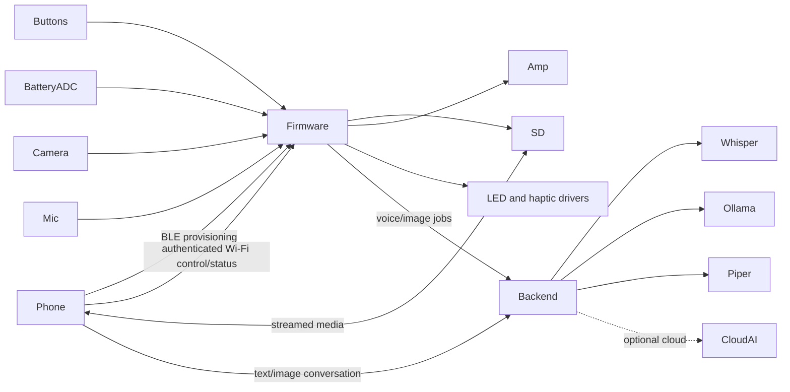

# Architecture and feasibility assessment

## Audited baseline

The repository already has a modular Arduino firmware and Flask backend. Firmware modules cover a bounded state machine, SD journaling, canonical 16 kHz PCM WAV capture, MAX98357A playback, Wi-Fi, HTTP jobs, OV3660 JPEG capture, explicit visual context, basic voltage reading, two debounced buttons, and disabled light/haptic outputs. The backend provides authenticated asynchronous jobs, faster-whisper, text and vision providers, Piper, conversation persistence, image ownership, bounded storage, tests, and diagnostics.

Actual source entry points are `firmware/InspectPinAI/InspectPinAI.ino`, `app_state_machine.*`, and `backend/receiver.py`. The optimized photo profile is centralized in `camera_profile.h` and applied by `camera_manager.cpp`. The present firmware states are BOOT, INITIALIZING, READY, RECORDING, SAVING, UPLOADING, WAITING_FOR_AI, DOWNLOADING, PLAYING, OFFLINE, RETRYING, ERROR, and LOW_BATTERY.

The audit found no `mobile_app/` or `hardware/` directory. There is no video writer, device HTTP control server, BLE/SoftAP provisioning, power manager, sleep implementation, command dispatcher, media catalogue, charging-status input, non-blocking haptic scheduler, PWM light controller, calibrated state-of-charge estimator, or mobile API. Optional battery/light/haptic code is disabled and minimal: 16-sample voltage averaging, a blocking 60 ms motor pulse, and binary illumination during photo capture.

The repository contains working-tree changes from prior volume and speech-normalization work. Future phases must preserve them and must not reset or overwrite unrelated user changes.

## Feasibility decisions

| Requirement | Decision |
|---|---|
| Physical OFF with button wake | Requires a latching load switch/power controller. Software deep sleep is the first implementation and is not physical disconnection. |
| Deep-sleep wake | Prefer D5/GPIO6 for the power/wake button. GPIO6 is RTC-capable and is not listed as a strapping pin. D2/GPIO3 is RTC-capable but is a strapping pin and must remain released during reset. |
| Two final buttons | Proposed final mapping: D5/GPIO6 power/wake; D2/GPIO3 speech/command. Short D2 starts voice; long D2 captures a photo when idle. This requires rewiring the current D5 camera-button bench arrangement and validation. |
| Voice during deep sleep | Impossible without separate always-on audio hardware. Button wake must precede listening. |
| Video | Implement silent JPEG-frame AVI/MJPEG first. Start with QVGA/VGA and a measured 5–10 fps target; make values configurable only inside tested limits. ESP32-S3 has no hardware H.264/H.265 encoder. |
| Stop video by voice | A voice command may start video before camera recording. During recording, the guaranteed stop controls are the command button and authenticated mobile command. Continuous Whisper stop-word detection is an experimental later milestone. |
| Photo profile | Preserve the current SVGA 800×600 optimized profile. Add a separate explicit video profile; never silently mutate the photo profile. |
| Flashlight | GPIO43 can control only a MOSFET/driver input. It conflicts with UART0 TX use, so USB CDC must remain the diagnostic path. Default off after boot/sleep/error. |
| Haptic | GPIO44 can control only a transistor/MOSFET or haptic driver. It conflicts with UART0 RX use. Use a timer-driven pattern queue; never block the state machine. |
| Battery | GPIO5/ADC1_CH4 with 47 kΩ/47 kΩ gives 2.1 V at a 4.2 V cell and about 44.7 µA divider current. Treat percentage as an estimate with calibration, filtering, hysteresis, and chemistry profile. |
| Charging | The onboard SGM40567 `nCHG` node is electrically represented by the onboard LED network, but its native pattern is about 160 ms low every 1.28 s while charging and only 51.2 s continuous low after completion. Use the separate VBUS-powered decoder in `09_SINGLE_LED_CHARGE_INDICATOR.md` for exact 1 Hz blinking, latched full indication, and mobile-readable state. Fault remains unknown without another signal. |
| Provisioning | BLE GATT provisioning is preferred for credentials and initial pairing; use Wi-Fi HTTP for control and large media. SoftAP is a documented fallback if BLE memory/reliability fails acceptance. |
| Control transport | Add an authenticated device API distinct from the existing AI backend API. Use request IDs, acknowledgments, timeouts, and idempotent commands. Start with polling; add WebSocket events only after stable HTTP control. |
| Media transfer | Stream ranged/chunked files from SD. Never load complete AVI/WAV/JPEG files into ESP32 application RAM. |
| Provider secrets | Store cloud keys on the backend. The phone may call authenticated management endpoints but must not send provider keys to firmware. |

## Final logical architecture

The firmware owns actual device state. The mobile app updates only after device acknowledgment. The backend owns AI provider configuration and conversation jobs. The device API owns power, capture, video, light, volume, haptic, battery, diagnostics, and media metadata. Cross-channel IDs correlate a device action with any resulting backend job.

## State-machine resolution

Use hierarchical states rather than multiplying every condition. Top-level power states are DEEP_SLEEP, LIGHT_SLEEP, BOOTING, INITIALIZING, ACTIVE, ERROR, and RECOVERY. ACTIVE contains READY, VOICE_LISTENING, AUDIO_RECORDING, IMAGE_CAPTURE, VIDEO_RECORDING, MEDIA_SAVING, WIFI_CONNECTING, UPLOADING, AI_PROCESSING, DOWNLOADING, and AUDIO_PLAYBACK. Charging, low battery, connectivity, flashlight, and haptic are orthogonal status flags.

Sleep requests are rejected or deferred while recording, finalizing a file, writing a journal, uploading a non-repeatable request, downloading, or playing. Video stop always finalizes the AVI index/header before a sleep transition. Critical battery requests graceful finalization, disables light/haptic, persists state, then deep sleeps. Physical-off behavior is enabled only for a verified latch circuit.

Priority order is: critical power protection; explicit cancel/stop; media finalization; user operation; reconnection/retry; status/telemetry; cosmetic feedback. A source-neutral command dispatcher receives button, voice, serial, BLE, and HTTP commands and returns the same typed result.

## Experimental validation still required

- Sleep and active current on the exact assembled board, including SD, amplifier, camera, divider, drivers, and regulator.
- GPIO6 wake from deep sleep and GPIO3 boot behavior with the actual switches.
- Battery-only MAX98357A supply; the XIAO 5 V pin is not powered from Li-Po according to Seeed documentation.
- Divider calibration at several voltages and under Wi-Fi/audio load.
- Whether any selected board revision exposes VBUS or CHG safely to firmware.
- Motor and LED ratings, driver component values, conducted noise, thermal behavior, and microphone interference.
- Sustainable AVI resolution/fps, SD write latency, file finalization, recovery, and playback on Windows/Android.
- BLE provisioning reliability and coexistence with Wi-Fi/PSRAM/camera.
- Physical end-to-end camera label accuracy and spoken output quality.

## Conflicts resolved

The requested “wake up” voice command is meaningful only while awake; genuine deep sleep requires a button/timer wake. “Power off” in the initial product means deep sleep unless load-switch hardware is fitted. Charging state remains unknown to firmware without additional sensing. Silent video is the accepted first release. Mobile hotspot creation remains a user/platform action; the app can guide and provision credentials but cannot bypass Android/iOS restrictions.

